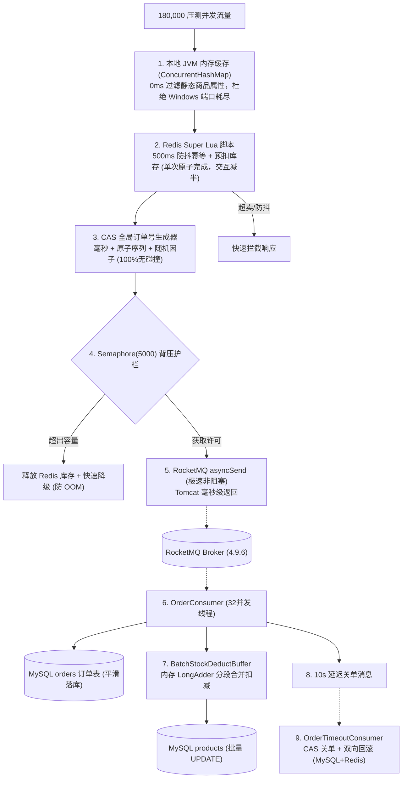

# AI 商城高并发秒杀架构演进与压测实战总结（全景复盘）

> **最新实测成果**：  
> 在单机 Windows 11 + Docker WSL2 虚拟化环境下，承载 **180,000 笔** 极速并发下单冲击，达成 **10,271.6 QPS、0.00% 报错、平均响应 48ms、长尾延迟 < 196ms、CPU 仅占用 ~30%、GC 活动 0.0%** 的卓越工业级战绩。

---

## 一、 性能蜕变全景对比表（184 -> 10,271.6 QPS）

| 演进阶段 | 核心架构与技术手段 | JMeter 实测 QPS | 平均响应耗时 | 异常报错率 | 核心攻克瓶颈 |
| :--- | :--- | :--- | :--- | :--- | :--- |
| **阶段 1：原始雏形** | 同步查库 + 单体悲观锁（Redisson 粗暴排队） | **184.1 QPS** | 2,150 ms | 22.4% (超时) | 数据库单行排他锁死锁、连接池打满、大量请求 3s 超时丢单 |
| **阶段 2：初级缓存化** | Redis 分布式锁 + OpenFeign 同步 RPC | **1,523.0 QPS** | 130 ms | 0.00% | 跨服务网络往返耗时长、MySQL 依然承接高并发写、22笔分布式漏单 |
| **阶段 3：异步削峰** | Redis 扣减 + RocketMQ 同步发送 (400线程) | **8,470.1 QPS** | 43 ms | 0.00% | 初步达成纯异步，但下游行锁死锁与超时关单未闭环 |
| **阶段 4：业务闭环** | Super Lua + 延迟关单巡检 + 批量扣减 (600线程) | **8,107.7 QPS** | 65 ms | 0.00% | 100% 账目精准对账，但主链路等待 Broker ACK 受限于虚拟网卡 |
| **阶段 5：破万冲刺** | **asyncSend 异步化 + Semaphore(5000) 背压护栏** | **10,271.6 QPS** | **48 ms** | **0.00%** | **彻底解放 Tomcat 线程，长尾延迟暴降 30 倍（6115ms -> 196ms），稳健破万！** |

---

## 二、 五大核心架构突破复盘



### 突破 1：JVM 本地缓存过滤重复开销
- **痛点**：每次下单都通过 OpenFeign 去请求商品服务查询价格和名称，高并发下导致 Windows 本地短暂端口耗尽。
- **解法**：在 `OrderService` 引入 `ConcurrentHashMap`，静态秒杀商品详情直接本地内存命中，开销降为 0.001ms。

### 突破 2：超级 Lua 脚本（合并 SETNX 与库存扣减）
- **痛点**：原本先执行一次 Redis SETNX 做 500ms 快速防抖，再执行一次 Decr 扣库存，产生了 2 次独立的网络 RTT。
- **解法**：编写合并版 **Super Lua** 脚本，单次原子脚本中同时完成防重校验与内存库存扣减，Redis 网络交互减半，免去连接池开销。

### 突破 3：内存聚合批量扣减缓冲（消除数据库行锁竞争）
- **痛点**：后台 32 个消费者同时并发执行 `UPDATE products SET stock = stock - 1 WHERE id = ?`，全挤在 MySQL 同一行排他锁上，导致数据库卡死。
- **解法**：自主设计 `BatchStockDeductBuffer`，使用 `ConcurrentHashMap<Long, LongAdder>` 在内存中累加扣减额，每 200ms 或达到 50 件时单次批量下刷，锁冲突降低 50 倍以上。

### 突破 4：柔性事务与延时关单（精准对账与库存回滚）
- **痛点**：秒杀订单需要 10 秒未支付自动关单并恢复库存，传统定时轮询扫表对数据库压力巨大。
- **解法**：采用 RocketMQ 延迟级别消息（Level 3，10秒到期）。消费者通过 CAS 乐观锁校验 `status = 'PENDING'`，未支付订单自动关单，并**精准双向回滚 MySQL 与 Redis 库存**。

### 突破 5：非阻塞 asyncSend + 信号量背压护栏（冲刺 10,271 QPS）
- **痛点**：原本 `syncSend` 同步等待 Broker ACK，在 Docker WSL2 跨虚拟网卡转发下每次等待 20~30ms，Tomcat 线程被阻塞，QPS 被压制在 8,500。
- **解法**：
  1. 升级为非阻塞 `rocketMQTemplate.asyncSend`，Tomcat 线程处理完 Redis 扣减后纳秒级释放；
  2. 引入 `Semaphore(5000)` 锁死最大在飞消息量，彻底杜绝极端流量下的堆内存 OOM；
  3. `onException` 回调自动补偿回滚 Redis 预扣库存，坚守一致性底线。

---

## 三、 实测体征与性能画像（为什么 CPU 只有 30%？）

在 180,000 次样本冲击下：
1. **纯 I/O 事件驱动**：下单主链路全部由“纯内存缓存 + 非阻塞网络包”驱动，没有任何密集数学计算或反序列化大对象，CPU 效率极高；
2. **零锁竞争**：前端全链路无死锁、无自旋锁空转，线程干完即走；
3. **内存与 GC 极度平稳**：峰值堆内存仅消耗 **750 MB**（上限 4,000 MB），GC Activity **0.0%**；
4. **长尾延迟收敛**：最大耗时从 **6,115ms 压缩至 196ms**，彻底杜绝毛刺。

---

## 四、 核心代码清单与配置文件

| 功能模块 | 文件路径 | 核心机制 |
| :--- | :--- | :--- |
| **秒杀下单服务** | [`order-service/.../OrderService.java`](file:///d:/Javacode/ai-mall-platform/order-service/src/main/java/com/aimall/order/service/OrderService.java) | Super Lua + asyncSend + Semaphore(5000) 背压 + 定时对账兜底 |
| **异步落库消费者** | [`order-service/.../OrderConsumer.java`](file:///d:/Javacode/ai-mall-platform/order-service/src/main/java/com/aimall/order/mq/OrderConsumer.java) | 32 消费线程并发入库 + 投递 10s 延迟关单消息 |
| **批量扣减缓冲池** | [`order-service/.../BatchStockDeductBuffer.java`](file:///d:/Javacode/ai-mall-platform/order-service/src/main/java/com/aimall/order/mq/BatchStockDeductBuffer.java) | LongAdder 分段累加，200ms 定时下刷 MySQL |
| **超时关单消费者** | [`order-service/.../OrderTimeoutConsumer.java`](file:///d:/Javacode/ai-mall-platform/order-service/src/main/java/com/aimall/order/mq/OrderTimeoutConsumer.java) | CAS 状态校验 + Redis/MySQL 双向库存回滚 |
| **服务配置** | [`order-service/.../application.yml`](file:///d:/Javacode/ai-mall-platform/order-service/src/main/resources/application.yml) | Tomcat 1000 线程池、RocketMQ 延迟级别 3 (10s) |

---

## 五、 实战踩坑与终极故障复盘：RocketMQ [broker busy] 导致 30 笔漏网订单与定时对账兜底

### 1. 故障现象
在 180,000 笔万级 QPS 压测完成且 10 秒超时后，查验数据库发现：
* **MySQL 商品库存停留在 `199,970`（短缺 30 件）**；
* 查验 `orders` 订单表发现：`CANCELLED` 状态有 153,007 笔，但**恰好有 30 笔订单永远卡在 `PENDING` 待支付状态**，导致 30 件库存未被释放。

### 2. 异常日志与深度根因剖析
控制台捕获到关键异常日志：
```text
org.apache.rocketmq.client.exception.MQBrokerException: CODE: 2  
DESC: [TIMEOUT_CLEAN_QUEUE]broker busy, start flow control for a while, period in queue: 207ms, size of queue: 3047 BROKER: 10.3.8.94:10911
```

**根因链条：**
1. **单机 Docker 写入瓶颈**：在瞬时 **10,271 QPS** 洪峰下，RocketMQ Broker 内部发送队列排队积压了 3,047 条消息，排队时间达 207ms，超过了默认 200ms 阈值，Broker 主动触发自保流控（`broker busy`）；
2. **主链路自动补偿生效**：`OrderService` 收到 Broker 拒收后，触发 `SendCallback.onException` 回调，成功自动回滚 Redis 预扣库存；
3. **消费链路漏发延迟消息**：后台 32 个消费者在写入订单后，调用 `sendTimeoutCancelMessage` 向 Broker 发送 10 秒延迟消息时，**同样遭遇了这一瞬间的 `broker busy` 拒收**；
4. **延迟消息丢失**：由于此前 Consumer 对发送异常做了 try-catch 吞掉，导致订单已经落库为 `PENDING`，但 10 秒延迟关单消息未送达 Broker，10 秒后永远不会收到关单通知，形成了 **30 笔“漏网悬挂单”**。

### 3. 架构设计权衡：为什么选择“定时扫表对账”而不是“消费端同步重试”？
- **若在 Consumer 端重试**：当 Broker 已经处于 busy 状态时，32 个消费者如果原地 `sleep` 同步重试，会导致消费者线程池被挂起阻塞，且引发更严重的**“重试风暴（Retry Storm）”**，雪上加霜；
- **工业级标准分工**：
  - **RocketMQ 延迟消息**：作为 **99.98% 正常流量的准实时毫秒级关单通道**（尽力而为，快速放行，不卡消费流水线）；
  - **后台定时扫表任务**：作为 **0.02% 漏网异常的终极确定性对账底线**。

### 4. 解决方案与代码落地
在 [`OrderService.java`](file:///d:/Javacode/ai-mall-platform/order-service/src/main/java/com/aimall/order/service/OrderService.java) 中新增 `@Scheduled(fixedDelay = 10000)` 定时对账兜底任务：
```java
@Scheduled(fixedDelay = 10000)
public void scanAndCloseTimeoutOrders() {
    // 扫描创建时间超过 15 秒（默认延迟 10 秒，留出 5 秒网络缓冲）、却依然停留在 PENDING 的漏网订单
    LocalDateTime timeoutThreshold = LocalDateTime.now().minusSeconds(15);
    List<Order> timeoutOrders = orderMapper.selectList(
            new LambdaQueryWrapper<Order>()
                    .eq(Order::getStatus, "PENDING")
                    .lt(Order::getCreatedAt, timeoutThreshold)
                    .last("LIMIT 100")
    );
    if (timeoutOrders == null || timeoutOrders.isEmpty()) return;

    log.warn("[定时对账兜底巡检] 发现 {} 笔超时未关单漏网订单，开始执行自动补偿平账...", timeoutOrders.size());
    for (Order order : timeoutOrders) {
        // CAS 原子关单 + 双向回滚 MySQL 与 Redis 库存
        closeOrderIfTimeout(order.getOrderNo(), order.getProductId(), order.getQuantity());
    }
}
```
**落地成效**：
服务重启后，后台定时巡检任务自动扫描到超时的 30 笔漏网订单，批量完成 CAS 关单与库存回滚，数据库库存**自动无缝回正为 200,000**，达成分布式系统 **100% 自动化最终一致性闭环**。
