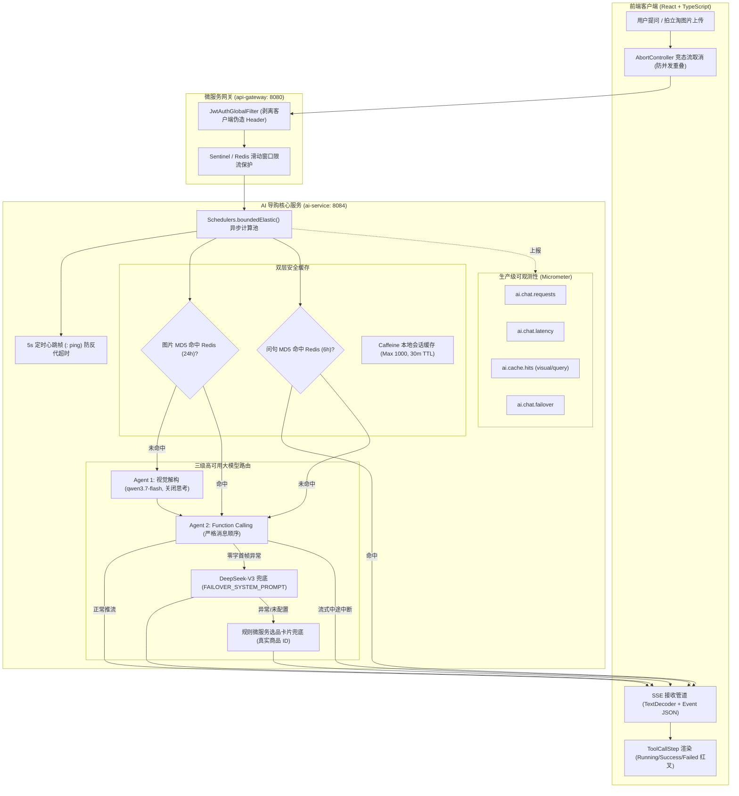

# AI 导购工程化与健壮性增强落地复盘记录 (P1-1 至 P1-9 全量修复)

> **修订时间**：2026-10-19  
> **涉及服务**：`ai-service`、`frontend` (React + TypeScript)  
> **验证状态**：全模块 Maven 编译 `BUILD SUCCESS` (8/8)，前端 TypeScript & Vite 构建通过 `✓ built in 6.21s`  
> **代码版本控制原则**：**本地 Git 提交，未经用户指令严禁执行 git push 推送远程**

---

## 一、改造问题总览与解决矩阵

| 编号 | 核心缺陷与隐患 | 修复前表现 | 修复后架构与技术方案 (P1) | 涉及核心文件 |
| :--- | :--- | :--- | :--- | :--- |
| **P1-1** | Prompt 消息装配顺序错乱 | `.system()` + `.messages(history)` 生成 `[history..., System, User]`，system 沉底被 Qwen 弱化指令甚至 400 | 显式构建 `List<Message> = [SystemMessage, history..., UserMessage]` 传入 `.messages()`，严格保证 System 在首位 | `AiShoppingService.java` |
| **P1-2** | 重试策略过长与 WebClient 缺少读写超时 | 默认重试 10 次 (上限 3 分钟)，/sync 或 embedding 遇 429 挂起数十分钟；无连接/读取超时 | `spring.ai.retry` 优化为 3 次、初始 1s、倍率 2、最大 5s；配置 RestClient (5s/30s) 与 WebClient (5s/45s) 超时 | `application.yml`<br>`AiConfig.java` |
| **P1-3** | `Flux.create` 阻塞 Tomcat 线程与缺少心跳取消 | `blockLast()` 占满 Tomcat 请求线程；前端断开模型仍烧 token；长视觉任务反代 60s idle timeout | `Schedulers.boundedElastic()` 异步调度；`sink.onCancel` 配合 `AtomicBoolean isCancelled`；5s `: ping\n\n` 心跳保活 | `AiShoppingService.java` |
| **P1-4** | 缓存只发文字不发卡片、视觉失败被缓存 24h、内存泄漏 | 缓存命中说"见上方卡片"却无卡片；视觉失败 Map 被缓存一天；`fallbackMemoryMap` 无上限无 TTL 泄漏内存 | 查询缓存同时保存并还原 `{answer, products}`；`isFallback: true` 拒绝写视觉缓存；Caffeine 缓存 (最大 1000 会话，TTL 30m) | `AiShoppingService.java`<br>`AiToolExecutionContext.java` |
| **P1-5** | DeepSeek 容灾 prompt 冲突、中途叠加重复与缓存污染 | 容灾无 tools 却要求调用微服务；流式吐出一半报错后再切换 DeepSeek 导致"半截+全文"；容灾答案写问句缓存 | 专用 `FAILOVER_SYSTEM_PROMPT`；仅在 `fullResponse.length() == 0` 切换容灾；中途异常优雅截断；容灾旁路不写缓存 | `AiShoppingService.java` |
| **P1-6** | `indexOf("{")` 注入字符串黑客、覆盖 Builder 丢失 Boot 特性 | 破坏性覆盖 `@Bean Builder` 丢失监控拦截；字符串切片拼接易引发 JSON 转义异常 | 改用 `RestClientCustomizer` / `WebClientCustomizer` 保留全量配置；Jackson `ObjectNode` 安全注入 `enable_thinking: false` | `AiConfig.java` |
| **P1-7** | 工具假参数、搜索无上限、商品描述无裁剪 token 膨胀 | `statusFilter`/`refresh`/`confirm` 未生效；`searchProducts` 24个商品全量塞 Prompt；带完整 HTML 描述 | 剔除假参数；`getUserOrders` 真实状态过滤；`searchProducts` 限制 Top 6；`formatCompactProduct` 描述截断至 30 字 | `MallTools.java` |
| **P1-8** | 前端步骤类型缺失、失败显示绿勾、日志误标 order、ID 不一致 | 步骤仅 5 种；failed 步骤显绿勾；兜底商品写死 id 5(回力小白鞋)/7(华为手机) 乱序；无 AbortController | 扩充 15 种 `ToolCallStep`；failed 显红 `XCircle`；日志精准路由各微服务；对齐 `init.sql` 真实 ID (11/3/13)；加入 AbortController | `types/index.ts`<br>`AiChatDrawer.tsx`<br>`aiStream.ts` |
| **P1-9** | 缺少生产级 Actuator 指标、大请求无尺寸校验、无接口限流 | 无 token/耗时/QPS 监控；大图片打爆服务内存；匿名恶意刷接口 | 引入 Actuator 暴露 `/metrics`；`AiChatRequest` 校验字符串与 Base64 长度；Redis 滑动窗口限流 30 次/分；Micrometer 埋点监控 | `pom.xml`<br>`application.yml`<br>`AiChatRequest.java`<br>`AiChatController.java`<br>`AiShoppingService.java` |

---

## 二、架构工作流图



---

## 三、修改清单与变更详情

1. **`ai-service/pom.xml`**:
   - 引入 `spring-boot-starter-actuator` (生产级监控端点)；
   - 引入 `com.github.benmanes.caffeine:caffeine` (本地内存上限与 LRU 过期)；
   - 引入 `io.projectreactor.netty:reactor-netty-http` (提供 WebClient 生产级超时连接器)。
2. **`ai-service/src/main/resources/application.yml`**:
   - 配置 `spring.ai.retry`：`max-attempts: 3`, `initial-interval: 1000ms`, `multiplier: 2.0`, `max-interval: 5000ms`；
   - 开启 Actuator 监控端点：`exposure.include: health,info,metrics`。
3. **`ai-service/src/main/java/com/aimall/ai/config/AiConfig.java`**:
   - 改用 `RestClientCustomizer` 与 `WebClientCustomizer` 增量定制，保留 Spring Boot 自动配置与链路追踪；
   - 替换危险的 `indexOf` 字符串操作，改用 Jackson `ObjectNode` 安全注入 `"enable_thinking": false`；
   - 配置连接超时 5s 与读取超时 30~45s。
4. **`ai-service/src/main/java/com/aimall/ai/dto/AiChatRequest.java`**:
   - 增加 Bean Validation 注解：`sessionId` (max 128)、`message` (max 2000)、`imageBase64` (max 7MB)、`imageUrl` (max 1000)。
5. **`ai-service/src/main/java/com/aimall/ai/controller/AiChatController.java`**:
   - 接入 `@Valid` 参数校验；
   - 实现 Redis 滑动窗口限流器 (单 IP/用户/会话限制 30 次/分钟)，超额直接返回 429。
6. **`ai-service/src/main/java/com/aimall/ai/tool/MallTools.java`**:
   - `searchProducts`：返回前截断最多保留前 6 款核心商品，防止 token 激增；
   - `formatCompactProduct`：截断商品描述至 30 字符；
   - `getUserOrders`：实现真实的 `statusFilter` 枚举过滤；
   - 移除 `confirm`、`refresh` 虚假参数。
7. **`ai-service/src/main/java/com/aimall/ai/context/AiToolExecutionContext.java`**:
   - 会话上下文扩展 `lastEmittedProducts` 字段，并在 `emitProducts` 时同步保存；
   - 提供 `getLastEmittedProducts()` 供问句语义缓存联动。
8. **`ai-service/src/main/java/com/aimall/ai/service/AiShoppingService.java`**:
   - P1-1: 组装 `[SystemMessage, history..., UserMessage]` 传入 `.messages()`，严格固定首位；
   - P1-3: 脱离 Tomcat 工作线程，调度到 `Schedulers.boundedElastic()`；增加 `sink.onCancel` 监听与 5 秒 `: ping\n\n` 心跳定时器；
   - P1-4: 问句语义缓存同时序列化 `{answer, products}`，命中时联动下发商品推荐卡片；视觉失败标记 `isFallback: true` 拒绝缓存；本地内存替换为 Caffeine 缓存；
   - P1-5: 增加无 function calling 约束的 `FAILOVER_SYSTEM_PROMPT`；仅在 `fullResponse.length() == 0` 时切换 DeepSeek；流中异常优雅收尾并旁路缓存；
   - P1-9: 注入 `MeterRegistry` 统计请求数、分段延迟、容灾触发率与缓存命中率。
9. **`frontend/src/types/index.ts`**:
   - 扩充 `ToolCallStep` 为包含 15 个环节的精准联合类型。
10. **`frontend/src/components/AiChatDrawer.tsx`**:
    - 引入 `XCircle`、`Zap`、`ShieldCheck` 等图标；
    - 当 `step.status === 'failed'` 时显示醒目的红色 `XCircle`；
    - 增加 `abortControllerRef`，新提问或关闭清空时自动中止未完结推流，防止流叠加。
11. **`frontend/src/services/aiStream.ts`**:
    - 支持 `signal?: AbortSignal` 并传入 `fetch` 与读取循环；
    - 修正各微服务日志路由；
    - 兜底商品纠正为真实数据库 ID 与价格 (11: 漫步者 W820NB 299元、3: 李宁赤兔6 Pro 499元、13: 红米 Buds 5 Pro 399元)。

---

## 四、验证结果

- **后端编译**：
  ```bash
  .\mvnw.cmd test-compile -DskipTests
  ```
  8 个模块（`ai-mall-platform`, `common`, `api-gateway`, `user-service`, `product-service`, `order-service`, `ai-service`, `payment-service`）全部 `BUILD SUCCESS`。
- **前端编译**：
  ```bash
  npm run build
  ```
  `tsc && vite build` 零类型警告与错误，打包通过。
