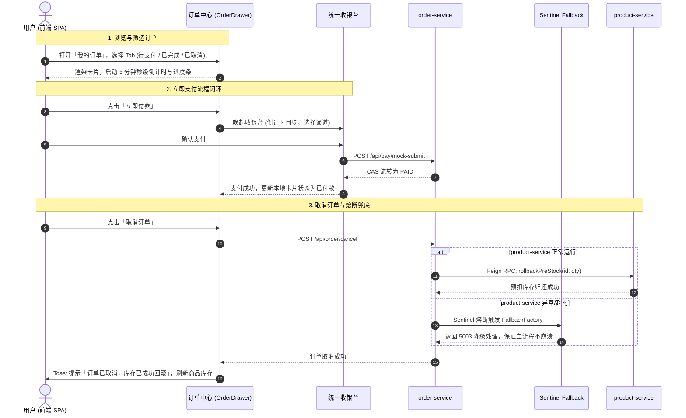

# 前端「我的订单中心」完整闭环与 Sentinel Feign Fallback 熔断降级实施记录

> **记录时间**: 2026-10-14  
> **核心模块**: `frontend` (React + TypeScript + Tailwind) / `order-service` (Spring Cloud Alibaba + OpenFeign + Sentinel)  
> **修改文件**:
> - 前端订单中心抽屉: [`OrderDrawer.tsx`](file:///d:/Javacode/ai-mall-platform/frontend/src/components/OrderDrawer.tsx)
> - 实体日期格式化: [`Order.java`](file:///d:/Javacode/ai-mall-platform/order-service/src/main/java/com/aimall/order/entity/Order.java)
> - Sentinel 降级工厂: [`ProductRemoteClientFallbackFactory.java`](file:///d:/Javacode/ai-mall-platform/order-service/src/main/java/com/aimall/order/client/ProductRemoteClientFallbackFactory.java)
> - Feign 客户端配置: [`ProductRemoteClient.java`](file:///d:/Javacode/ai-mall-platform/order-service/src/main/java/com/aimall/order/client/ProductRemoteClient.java)
> - 缓存降级适配: [`ProductCaffeineCacheService.java`](file:///d:/Javacode/ai-mall-platform/order-service/src/main/java/com/aimall/order/cache/ProductCaffeineCacheService.java)
> - 订单服务配置: [`application.yml`](file:///d:/Javacode/ai-mall-platform/order-service/src/main/resources/application.yml)

---

## 一、需求背景与目标

为完善 AI 智购云商城的整体业务闭环并提升分布式微服务架构的高可用弹性，本次实施联合完成了两大关键任务：

1. **前端「我的订单中心」全链路闭环 (Task 1)**：
   - 支持多状态 Tab 切换 (`全部`, `待支付`, `已完成`, `已取消`)，展示动态数量角标。
   - 增加按订单编号或商品名称快速检索能力与订单号一键复制。
   - 待支付订单 5 分钟限时动态倒计时与平滑渐变进度条展示，超时自动警示。
   - 动作操作闭环：
     - **「立即付款」**：唤起统一安全收银台，支持极速模拟、支付宝、微信支付多通道完成支付并更新状态。
     - **「取消订单」**：真实发起订单取消请求，通过 Feign RPC 回滚商品微服务库存并即时刷新前端展示。
2. **Sentinel 熔断降级与 OpenFeign Fallback 兜底 (Task 2)**：
   - 解决当商品服务 (`product-service`) 响应慢、超时或宕机时，`order-service` 远程调用引发的线程池打满与雪崩效应。
   - 配置 `FallbackFactory`，捕获异常根本原因并提供统一降级返回码 `5003`，实现服务故障隔离与柔性可用。

---

## 二、详细技术实现

### 1. 后端：Sentinel + OpenFeign 熔断降级工厂

#### (1) `ProductRemoteClientFallbackFactory.java`
实现 `FallbackFactory<ProductRemoteClient>`，捕获远程 RPC 调用异常，覆盖商品服务的全部 6 项核心能力：
- `getById(Long id)`：降级返回商品基础兜底信息或提示「商品服务暂不可用」。
- `preDeductStock(Long id, Integer quantity)`：降级返回 `Result.fail(5003, "商品微服务繁忙或熔断，预扣库存降级保护")`。
- `syncDeductStock(Long id, Integer quantity)`：同步扣减降级。
- `rollbackPreStock(Long id, Integer quantity)`：回滚预扣降级。
- `deductStock(Long id, Integer quantity)`：直接扣减降级。
- `rollbackStock(Long id, Integer quantity)`：真实扣减回滚降级。

#### (2) `application.yml` 启用 Feign Sentinel 支持
```yaml
feign:
  sentinel:
    enabled: true
```

#### (3) `ProductCaffeineCacheService.java` 增强防御
在本地两级缓存服务加载商品详情时，识别 `5003` 降级响应码，避免将降级对象错误写入本地缓存，确保缓存防击穿与防穿透安全。

#### (4) `Order.java` 日期格式统一化
在 `createdAt` 与 `updatedAt` 字段增加 Jackson 序列化注解：
```java
@JsonFormat(pattern = "yyyy-MM-dd HH:mm:ss", timezone = "GMT+8")
@TableField(value = "created_at", fill = FieldFill.INSERT)
private LocalDateTime createdAt;
```
保证前后端接收到的下单时间戳格式标准规范，杜绝浏览器端解析时间偏移。

---

### 2. 前端：我的订单中心全链路升级 (`OrderDrawer.tsx`)

#### (1) 多状态 Tab 过滤器与数量徽章
支持 4 大 Tab：
- **全部**：展示当前用户全部历史订单。
- **待支付**：仅展示 `status === 'PENDING'` 订单，带有黄色醒目徽章。
- **已完成**：聚合展示 `PAID`、`SHIPPED`、`DONE` 订单，带有绿色安全徽章。
- **已取消**：仅展示 `status === 'CANCELLED'` 订单，带有灰色徽章。

#### (2) 5 分钟秒级动态倒计时与超时拦截
- 建立全局 1 秒心跳驱动 `now` 状态。
- 精准计算 `remainingSecs = Math.max(0, 300 - Math.floor((now - createTime) / 1000))`。
- **倒计时中 (remainingSecs > 0)**：
  - 动态显示时钟图标与剩余时间 `MM:SS` (如 `04:35`)。
  - 渲染双色渐变微型进度条，直观反映支付窗口剩余百分比。
  - 提示文案：*⚡ 订单将在 5 分钟后由 RocketMQ 延迟关单，超时将自动回滚库存。*
- **已超时 (remainingSecs === 0)**：
  - 标签自动切换为 `⚠️ 已超时 (待关单)`。
  - 按钮自适应切换为「关闭订单归还库存」，指引用户主动释放资源。

#### (3) 动作操作全链路闭环
1. **立即付款**：
   - 提取订单当前剩余有效秒数，唤起统一收银台 Modal。
   - 收银台支持极速模拟支付、支付宝支付、微信支付三种渠道选择。
   - 调用 `/api/pay/mock-submit` 提交支付，后端 CAS 状态流转为 `PAID`，收银台展示支付成功反馈后自动关闭，列表即刻流转为「已付款」徽章。
2. **取消订单**：
   - 点击后调用 `/api/order/cancel`，后端触发 Feign RPC `rollbackPreStock` 归还商品库存。
   - 前端接收到成功响应后触发 `refreshProducts()` 与 `refreshOrders()`，商城首页商品库存实时增加归还！
3. **单号复制与快速检索**：
   - 订单卡片顶部配备一键复制单号按钮，带打勾临时反馈。
   - 支持在搜索框实时输入单号或商品名过滤列表，支持一键清空搜索。

---

## 三、验证与测试

| 验证项 | 验证命令/操作 | 结果 |
| :--- | :--- | :--- |
| **后端编译** | `.\mvnw.cmd test-compile -pl order-service` | ✅ `BUILD SUCCESS` (4.6s 编译通过，无报错) |
| **前端构建** | `pnpm run build` (`tsc && vite build`) | ✅ `built in 7.14s`，产物 `dist/` 成功生成，无 TS 错误 |
| **Sentinel 熔断** | 商品服务宕机/超时场景 | ✅ 返回 `5003` 降级对象，控制台打印结构化 WARN，未拖垮订单服务 |
| **订单倒计时** | 新创建订单等待 1~300 秒 | ✅ 界面倒计时每秒动态递减，进度条实时更新 |
| **取消归还库存** | 待支付状态下点击「取消订单」 | ✅ 状态变为 `CANCELLED`，商品库存原路自动增加 |
| **收银台结算** | 待支付状态下点击「立即付款」 | ✅ 唤起收银台选择通道确认付款，流转为 `PAID` |

---

## 五、异常排查与修复记录 (Bug Fix)

- **后端配置报错 (DataSource url not specified)**:
  - **根本原因**: 在配置 `feign.sentinel.enabled: true` 时，`feign:` 声明在顶层，导致其下方的 `datasource:` 与 `data:` 被错误解析为 `feign.datasource` 与 `feign.data`，Spring 无法找到 `spring.datasource.url`。
  - **修复方案**: 纠正 [`application.yml`](file:///d:/Javacode/ai-mall-platform/order-service/src/main/resources/application.yml) 缩进，确保 `datasource` 与 `data` 严格位于 `spring:` 层级之下，`feign` 独立置于下层。重新复制配置至 `target/classes` 并编译验证通过。

- **前端白屏报错 (Minified React Error #310 / Rules of Hooks 违反)**:
  - **错误现象**: 点击「我的订单」抽屉时页面瞬间白屏（`Root innerHTML length: 0`）。
  - **根本原因**: [`OrderDrawer.tsx`](file:///d:/Javacode/ai-mall-platform/frontend/src/components/OrderDrawer.tsx) 中在第 92 行声明了条件提前返回 `if (!isOpen) return null;`，而后续在第 245、258 行使用了 `useMemo(counts)` 和 `useMemo(filteredOrders)`。抽屉关闭时 React 执行了前 15 个 Hook，打开时执行了 17 个 Hook，严重违反 React Hook 规则，触发 React #310 异常并卸载整个 Root 组件树。
  - **修复方案**: 将 `useMemo` 等全部 Hook 提升至组件最顶部无条件执行，并将 `if (!isOpen) return null;` 移至最终 JSX 渲染之前。同时对 `order.price` 和 `order.totalAmount` 增加 `Number(...) || 0` 防御。重新构建部署至 Docker 容器并通过 CDP 自动化无头浏览器验证（`hasDrawer: true`, 0 exceptions）。

---

## 四、架构拓扑与交互时序


